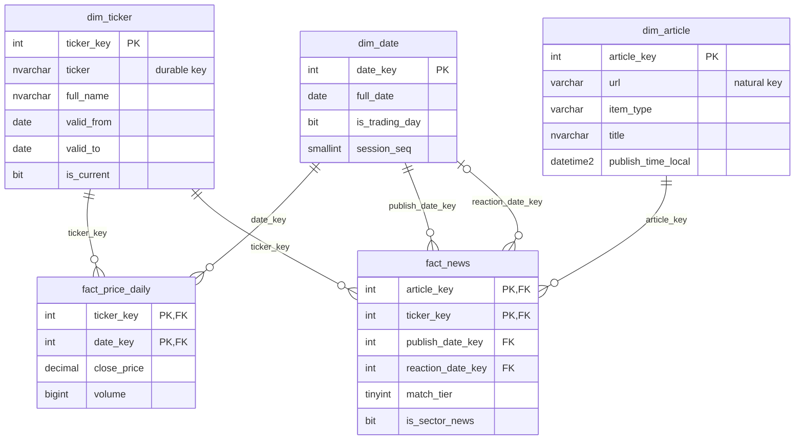
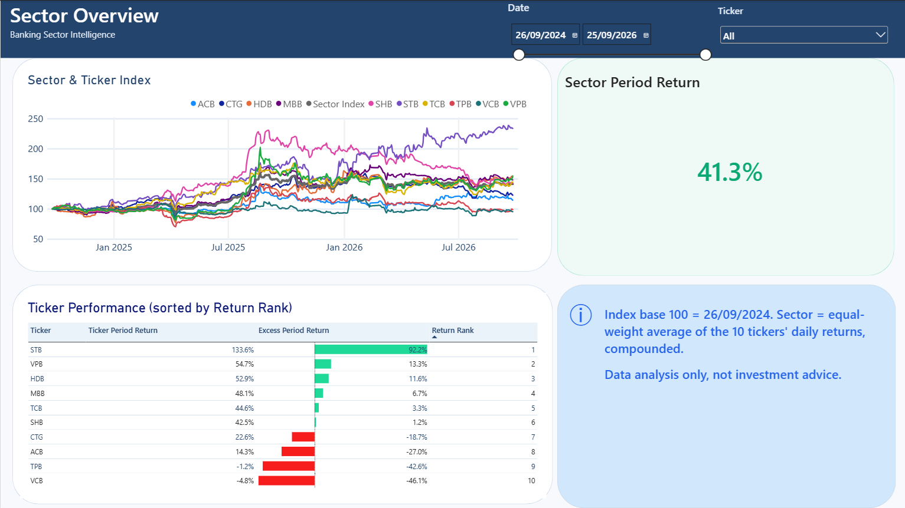
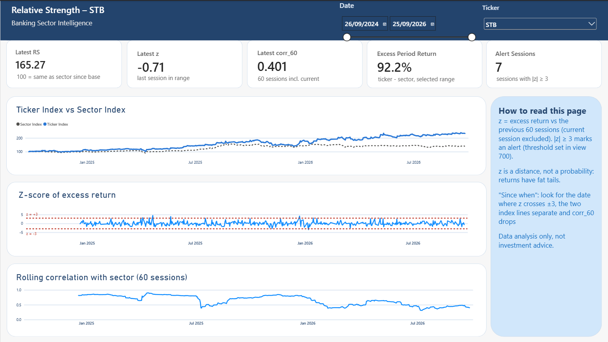
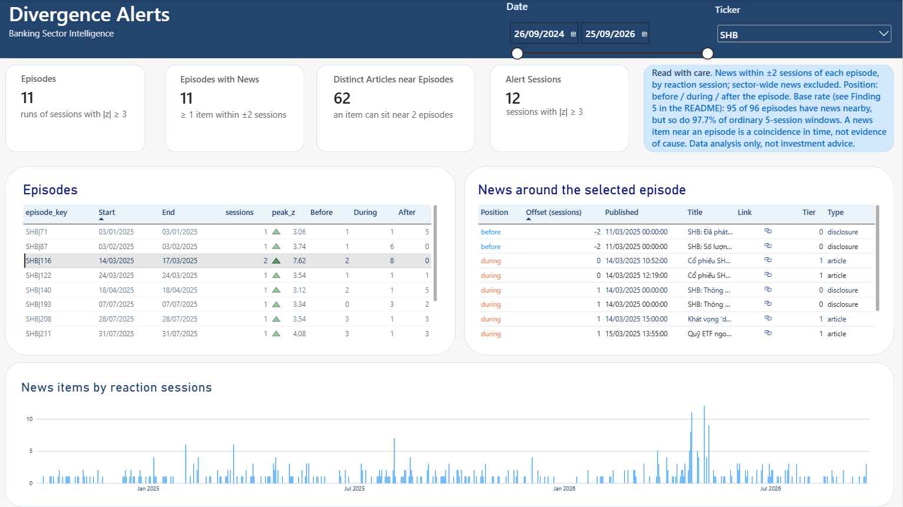

# Banking Sector Intelligence

A SQL-first data warehouse on 10 HOSE-listed Vietnamese banks
(VCB, CTG, TCB, MBB, ACB, VPB, STB, HDB, TPB, SHB), with a Power BI report on top.

**Central question:** which of these tickers is moving away from the sector, since when, and what
news appeared around that time.

> This is a data analysis project, not an investment recommendation tool.
> Nothing here is advice to buy or sell any security. News found near a price move is a coincidence
> in timing, not evidence that the news caused the move.

| | |
|---|---|
| Window | 2024-09-26 to 2026-09-25 (locked in `config/scope.yaml`), 497 trading sessions |
| Prices | VCI via `vnstock` 4.0.9, daily OHLCV, adjusted by the source; 4,970 rows in `fact_price_daily` |
| News | CafeF: daily sitemaps (articles) and per-ticker lists (company disclosures); 6,849 item-bank rows in `fact_news` |
| Database | SQL Server 2025 Express |
| Report | Power BI Desktop (PBIP format), Import mode, reads only the `mart.v_pbi_*` views |

---

## Architecture

```
VCI (vnstock) ─┐                                       ┌─ dq.sp_run_checks (11 checks, run history)
CafeF ─────────┴─ Python ─> raw ─> stg ─> dw (star) ─> mart (views) ─> Power BI
                  Phase 1   text   typed   dims+facts   analysis + report contract
```

| layer | what it holds | written by |
|---|---|---|
| `raw/` files | parquet (prices, calendar, committed), HTML and XML (news, not committed) | Python |
| `raw` schema | source values as text | Python (`ingest/`) |
| `stg` | typed, de-duplicated, cut to the window; title matching to banks | SQL (`sql/02_load`, `sql/03_transform/500`) |
| `dw` | star schema | SQL procedures (`sql/03_transform/400-510`) |
| `mart` | analysis views 600-710, report views 800-860 | SQL views |
| `dq` | data quality results, one row per check per run | `dq.sp_run_checks` |

**Python is used in Phase 1 only:** download prices, crawl CafeF, save the raw files, load them into
`raw` as text. No cleaning or calculation happens in Python. Everything after that is T-SQL:
typing and filtering, the dimensional model, the load procedures, news-to-bank matching, the
analysis (window functions), alert episodes, data quality checks.

## Star schema



- `fact_price_daily` is a periodic snapshot: one row per ticker per trading session.
- `fact_news` is a factless fact table: one row per news item per bank it is tied to.
- `dim_date` holds every calendar day (730 rows) with `is_trading_day` and `session_seq`
  (1..497 over trading days). It plays two roles in `fact_news`: publish date and reaction session.
- `dim_ticker` is SCD Type 2. One bank changed its name in the window (STB, 2026-06-01), so the
  table has 11 rows for 10 tickers. SCD2 is there mostly to show the technique; one rename would
  not force it.
- `dim_date` and `dim_ticker` are conformed: both fact tables use them.

Grain, key columns and descriptions of the main tables and views: [`docs/data_dictionary.md`](docs/data_dictionary.md).

## A representative query: z-score of excess return

`mart.v_excess_zscore` (`sql/03_transform/670`). Excess return = ticker return minus sector return
on the same session. The window is the 60 sessions **before** the current one, so a large move does
not widen its own standard deviation. Partition by `ticker` (durable key), not `ticker_key`: STB has
two keys and would otherwise restart its window at the rename. Order by `session_seq`, not by date,
so "60 sessions" means 60 trading sessions.

```sql
CREATE OR ALTER VIEW mart.v_excess_zscore AS
WITH w AS (
    SELECT ticker, session_seq, date_key, full_date, excess_ret,
        COUNT(excess_ret) OVER (PARTITION BY ticker ORDER BY session_seq
                                ROWS BETWEEN 60 PRECEDING AND 1 PRECEDING) AS n_prev,
        AVG(excess_ret)   OVER (PARTITION BY ticker ORDER BY session_seq
                                ROWS BETWEEN 60 PRECEDING AND 1 PRECEDING) AS mean_prev,
        STDEV(excess_ret) OVER (PARTITION BY ticker ORDER BY session_seq
                                ROWS BETWEEN 60 PRECEDING AND 1 PRECEDING) AS sd_prev
    FROM mart.v_relative_strength
)
SELECT ticker, session_seq, date_key, full_date, excess_ret, n_prev, mean_prev, sd_prev,
    CASE WHEN n_prev = 60 AND excess_ret IS NOT NULL
         THEN (excess_ret - mean_prev) / NULLIF(sd_prev, 0.0) END AS z
FROM w;
```

Structural check that follows from the definition: each ticker has 61 sessions without z
(session 1 has no return, then 60 sessions before the window is full). It holds for all 10.

Sector index: average the 10 daily returns per session, then compound
(`100 * EXP(SUM(LOG(1 + sector_ret)) OVER (ORDER BY session_seq))`). A period return is the ratio
of two index values, not a sum of daily returns.

## Report

Three pages, all read from `mart.v_pbi_*` views. DAX does display logic only (period return from
index ratios, ranks, titles); the series themselves come from SQL.

| page | shows |
|---|---|
| Sector Overview | sector index and ticker indices (base 100), period return and rank per ticker |
| Relative Strength | RS = 100 × ticker index / sector index, rolling 60-session correlation, z of excess return with the ±3 lines |
| Divergence Alerts | episodes (consecutive sessions with \|z\| ≥ 3), news within ±2 sessions, links to the source |





---

## Findings

Each finding comes with the query that produces it. Time-series calculations use `ticker` as the
partition key and `session_seq` to order trading sessions.

How to read the index columns: every index starts at 100 on the base date.
`ticker_index` = 233.6 means the ticker is up 133.6% since the base date; `sector_index` = 141.3
means the sector is up 41.3%. `rs` = 100 x ticker_index / sector_index compares the two:
rs = 165.3 means the ticker's index is 65.3% above the sector's, which is not the same as
"65.3 percentage points more return" (133.6 - 41.3 = 92.3 points).

### 1. SHB, 2025-03-14: the highest positive z-score over the two-year period

```sql
-- Highest positive z-scores over the two-year period
SELECT TOP (5) ticker, full_date, session_seq, excess_ret, z
FROM mart.v_excess_zscore
WHERE z IS NOT NULL
ORDER BY z DESC;

-- SHB against the sector around the episode
SELECT full_date, ret, sector_ret, excess_ret, rs
FROM mart.v_relative_strength
WHERE ticker = 'SHB' AND full_date BETWEEN '2025-03-12' AND '2025-03-20'
ORDER BY session_seq;

-- Why 18 March is not an alert: the standard deviation of its window
SELECT full_date, excess_ret, sd_prev, z
FROM mart.v_excess_zscore
WHERE ticker = 'SHB' AND full_date IN ('2025-03-17', '2025-03-18');

-- News within 2 sessions of the SHB episode
SELECT position, reaction_date, item_type, match_tier, title
FROM mart.v_episode_news
WHERE ticker = 'SHB' AND start_date = '2025-03-14'
ORDER BY reaction_seq, publish_time_local;
```

On 14 March 2025, SHB hit the daily price ceiling, rising 7.02% while the sector gained 0.93%. Its excess return was 6.09%, with a z-score of 7.62, the highest positive z-score over the two-year period. The episode continued on 17 March, with an excess return of 3.66% and a z-score of 3.20, while RS rose from 97.25 on 13 March to 106.84 on 17 March. On 18 March, the excess return was still 3.65%, but the z-score fell to 2.90, just below the threshold of 3. As the 60-session window rolled forward, the 17 March excess return entered and the 13 December 2024 excess return (-0.67%) left the window; the standard deviation rose by about 8%, mainly due to the incoming large excess return. Two announcements preceded the episode, including one about a share issue to pay a stock dividend, while two articles on 14 March reported SHB's ceiling-price gain. News linked to 17 March was published after the 14 March session. One article published on 15 March expected a foreign ETF to sell a large amount of SHB shares during its rebalancing; most of the other reports were routine or promotional. The available news does not establish what caused the price increase.

### 2. STB, above the sector after the base session

```sql
-- End of period and lowest RS, all tickers
WITH last_session AS (SELECT MAX(session_seq) AS seq FROM mart.v_relative_strength)
SELECT r.ticker,
       MAX(CASE WHEN r.session_seq = l.seq THEN r.rs END)           AS rs_end,
       MAX(CASE WHEN r.session_seq = l.seq THEN r.ticker_index END) AS ticker_index_end,
       MIN(CASE WHEN r.session_seq > 1     THEN r.rs END)           AS rs_min_after_base,
       MAX(CASE WHEN r.rs < 100 THEN r.full_date END)               AS last_session_below_100
FROM mart.v_relative_strength r
CROSS JOIN last_session l
GROUP BY r.ticker
ORDER BY rs_end DESC;

-- STB at the last session of each quarter
WITH q AS (
    SELECT r.full_date, r.rs, r.ticker_index, r.sector_index,
           ROW_NUMBER() OVER (PARTITION BY d.[year], d.[quarter] ORDER BY r.session_seq DESC) AS rn
    FROM mart.v_relative_strength r
    JOIN dw.dim_date d ON d.date_key = r.date_key
    WHERE r.ticker = 'STB'
)
SELECT full_date, rs, ticker_index, sector_index
FROM q WHERE rn = 1
ORDER BY full_date;

-- STB alert episodes
SELECT start_date, end_date, direction, sessions, peak_z, sum_excess_ret
FROM mart.v_alert_episode
WHERE ticker = 'STB'
ORDER BY start_seq;
```

By 25 September 2026, STB's RS had reached 165.27, with its price index rising 133.6% to 233.59, compared with a 41.3% gain in the sector index to 141.34. In 2026, the sector index fell from 145.00 to 141.34, while STB's price index rose from 177.10 to 233.59 by 25 September. The trend was not steady: RS fell 0.4% in Q1 2025 and 7.6% in Q3 2025, yet remained above 100 after the base session, with a low of 100.81 on 30 September 2024. STB had seven one-session alert episodes between April 2025 and 15 January 2026: six upward and one downward (z = -3.52 on 7 January 2026). Four of them occurred in Q2 2025, when RS rose 16.4%, its strongest quarterly gain. From the end of Q1 2026 to the end of the period, RS rose another 22.3%, from 135.18 to 165.27, without a single alert. This illustrates a limitation of the method: z-scores detect unusually large daily excess returns relative to the previous 60 sessions, but may miss a sustained trend when STB outperforms the sector by smaller amounts over many sessions.

### 3. Bank rankings changed sharply over the two-year period

```sql
-- End of period, all tickers
SELECT r.ticker,
       r.ticker_index,
       r.ticker_index - 100             AS period_return_pct,
       r.rs,
       RANK() OVER (ORDER BY r.rs DESC) AS rs_rank,
       r.sector_index
FROM mart.v_relative_strength r
WHERE r.session_seq = (SELECT MAX(session_seq) FROM mart.v_relative_strength)
ORDER BY r.rs DESC;

-- Highest and lowest ticker index at the last session of each quarter
WITH x AS (
    SELECT r.ticker, r.session_seq, r.date_key, r.full_date, r.ticker_index,
           ROW_NUMBER() OVER (PARTITION BY r.session_seq ORDER BY r.ticker_index DESC) AS rk_hi,
           ROW_NUMBER() OVER (PARTITION BY r.session_seq ORDER BY r.ticker_index ASC)  AS rk_lo
    FROM mart.v_relative_strength r
),
qe AS (
    SELECT d.date_key,
           ROW_NUMBER() OVER (PARTITION BY d.[year], d.[quarter] ORDER BY d.session_seq DESC) AS rn
    FROM dw.dim_date d
    WHERE d.is_trading_day = 1
)
SELECT x.full_date,
       MAX(CASE WHEN x.rk_hi = 1 THEN x.ticker END)       AS top_ticker,
       MAX(CASE WHEN x.rk_hi = 1 THEN x.ticker_index END) AS top_index,
       MAX(CASE WHEN x.rk_lo = 1 THEN x.ticker END)       AS bottom_ticker,
       MAX(CASE WHEN x.rk_lo = 1 THEN x.ticker_index END) AS bottom_index,
       MAX(CASE WHEN x.rk_hi = 1 THEN x.ticker_index END)
         / MAX(CASE WHEN x.rk_lo = 1 THEN x.ticker_index END) AS top_over_bottom
FROM x
JOIN qe ON qe.date_key = x.date_key AND qe.rn = 1
GROUP BY x.full_date
ORDER BY x.full_date;
```

By 25 September 2026, STB had the highest price index at 233.59 (+133.6%), while VCB had the lowest at 95.21 (-4.8%); the sector index stood at 141.34 (+41.3%). Six tickers ended with RS above 100 and four below; VPB, HDB, MBB, TCB and SHB formed a relatively tight middle group, with gains ranging from 42.5% to 54.7%, while the four below-sector tickers ranged from CTG (+22.6%) and ACB (+14.3%) to TPB (-1.2%) and VCB (-4.8%). The highest ticker index was 1.04 times the lowest at the end of Q3 2024, rising to 2.45 times by 25 September 2026. The largest proportional increases in this ratio occurred in Q1 2025 (+26.5%) and Q3 2025 (+24.2%); measured by absolute change, Q3 2025 saw the largest jump, from about 1.65 to 2.04. At quarter-end, SHB moved from last in Q4 2024 (95.33) to first in Q1 2025, then led again in Q3 and Q4 2025; from 204.67 at the end of Q3 2025, its index fell to 142.51 by period-end (about -30.4%), leaving it sixth. TPB led at the end of Q3 2024 before ranking last at the ends of Q1 and Q2 2025; VCB was last at every quarter-end from Q3 2025 onward, while STB was first at every quarter-end from Q1 2026 onward. The two March 2025 sessions in Finding 1 (+7.02% and +5.12%) together raised SHB's price by about 12.5%, part of its 34.8% rise in Q1 2025. These quarter-end snapshots cannot show which ticker led between quarter-ends or explain why the rankings changed.

### 4. TPB, 2025-03-20: the largest absolute z-score over the two-year period

```sql
-- Largest |z| in either direction
SELECT TOP (5) ticker, full_date, session_seq, excess_ret, z
FROM mart.v_excess_zscore
WHERE z IS NOT NULL
ORDER BY ABS(z) DESC;

-- Every ticker on 2025-03-20
SELECT ticker, ret, sector_ret, excess_ret, rs
FROM mart.v_relative_strength
WHERE full_date = '2025-03-20'
ORDER BY ret;

-- The same session without TPB
SELECT AVG(ret) AS mean_ret_without_tpb, COUNT(*) AS tickers
FROM mart.v_relative_strength
WHERE full_date = '2025-03-20' AND ticker <> 'TPB';

-- VCB around that session, its RS range before it, and its last session above 100
SELECT full_date, ret, sector_ret, excess_ret, rs
FROM mart.v_relative_strength
WHERE ticker = 'VCB' AND full_date BETWEEN '2025-03-17' AND '2025-03-25'
ORDER BY session_seq;

SELECT MIN(rs) AS rs_min, MAX(rs) AS rs_max
FROM mart.v_relative_strength
WHERE ticker = 'VCB' AND full_date < '2025-03-21';

SELECT MAX(full_date) AS last_session_above_100
FROM mart.v_relative_strength
WHERE ticker = 'VCB' AND rs > 100;

-- News within 2 sessions of the TPB episode
SELECT position, reaction_date, item_type, match_tier, title, publish_time_local
FROM mart.v_episode_news
WHERE ticker = 'TPB' AND start_date = '2025-03-20'
ORDER BY reaction_seq, publish_time_local;
```

On 20 March 2025, TPB fell 5.33% while the sector gained 0.10%, giving TPB an excess return of -5.43% and a z-score of -8.15, the largest absolute z-score over the two-year period. TPB was the only ticker to fall that day; the other nine rose by 0.14% to 1.67%, averaging 0.70%, but TPB's decline pulled the sector return down to 0.10%, so all nine recorded positive excess returns. Compared with the 0.70% average of the other nine tickers, only five (TCB, VPB, SHB, STB and MBB) did better; the other four, including VCB (+0.46%), fell short. Against the sector return as calculated, VCB's excess return of 0.36% pushed its RS to 100.35, making 20 March its last session above 100. Using the 0.70% average excluding TPB instead, VCB's RS would have been about 99.75, making 17 March its last session above 100, three sessions earlier. This changes the date of the milestone, not the broader picture: VCB's RS ranged from 95.02 to 105.53 through 20 March, then fell below 100 again on 21 March and continued to trail the sector. One article during the 20 March session reported TPB's sharp decline, and another article published after the close continued to cover the fall; reports of a board member's resignation appeared from 21 March onward and cannot explain the decline during the 20 March session. A disclosure dated 20 March about approval of an overdraft limit had no publication time and was assigned to the next session under the project's rule for date-only disclosures, so its actual timing relative to the price move is unknown. The available evidence does not establish what caused TPB's decline.

### 5. News around alerts does not establish causation

Base rate: the same ±2-session window around each eligible alert or ordinary session (z available
and a full five-session window); full query in `sql/04_quality/720_news_base_rate.sql`.

```sql
-- Alert sessions vs ordinary sessions
WITH news_per_session AS (
    SELECT t.ticker, rd.session_seq, COUNT(*) AS items
    FROM dw.fact_news f
    JOIN dw.dim_ticker t ON t.ticker_key = f.ticker_key
    JOIN dw.dim_date  rd ON rd.date_key  = f.reaction_date_key
    WHERE f.is_sector_news = 0
    GROUP BY t.ticker, rd.session_seq
),
s AS (
    SELECT z.ticker, z.session_seq, z.z, ISNULL(n.items, 0) AS items,
        SUM(ISNULL(n.items, 0)) OVER (PARTITION BY z.ticker ORDER BY z.session_seq
                                      ROWS BETWEEN 2 PRECEDING AND 2 FOLLOWING) AS items_5,
        COUNT(*)                OVER (PARTITION BY z.ticker ORDER BY z.session_seq
                                      ROWS BETWEEN 2 PRECEDING AND 2 FOLLOWING) AS session_in_window
    FROM mart.v_excess_zscore z
    LEFT JOIN news_per_session n ON n.ticker = z.ticker AND n.session_seq = z.session_seq
)
SELECT CASE WHEN ABS(z) >= 3 THEN 'alert' ELSE 'ordinary' END AS session_group,
       COUNT(*)                                        AS sessions,
       AVG(CASE WHEN items_5 > 0 THEN 1.0 ELSE 0 END)  AS share_window_with_news,
       AVG(CAST(items_5 AS decimal(12,3)))             AS avg_items_window,
       AVG(CAST(items   AS decimal(12,3)))             AS avg_items_on_session
FROM s
WHERE z IS NOT NULL AND session_in_window = 5
GROUP BY CASE WHEN ABS(z) >= 3 THEN 'alert' ELSE 'ordinary' END;

-- Episodes with at least one news item within 2 sessions
SELECT COUNT(*) AS episodes,
       SUM(CASE WHEN news_before + news_during + news_after > 0 THEN 1 ELSE 0 END) AS with_news,
       SUM(CASE WHEN news_before + news_during > 0 THEN 1 ELSE 0 END)              AS with_news_before_or_during
FROM mart.v_pbi_episode;

-- News items per session, by position around the episode (approximate denominators)
SELECT n.position,
       COUNT(*) AS items,
       CASE n.position WHEN 'during' THEN (SELECT SUM(sessions) FROM mart.v_alert_episode)
                       ELSE 2 * (SELECT COUNT(*) FROM mart.v_alert_episode) END AS sessions_in_position
FROM mart.v_episode_news n
WHERE n.article_key IS NOT NULL
GROUP BY n.position;
```

News presence alone did little to distinguish alert sessions from ordinary sessions: at least one news item appeared in the five-session window around 98.99% of alert sessions and 97.71% of ordinary sessions. However, news volume was higher around alerts, with about 27% more items across the five-session window and 37% more on the alert session itself; these are descriptive differences, and no statistical test was conducted. By timing, news volume was close to the ordinary-session level before episodes (about 1.10 items per session, versus 1.06) but higher during episodes (1.46, about 38% more) and after them (1.49, about 42% more). These timing estimates are approximate because overlapping episode windows counted 43 news items twice, and the calculation assumed two sessions before and after each episode. A manual review of 20 headlines in `docs/during_sample.csv` found four reports about price movements, six about significant bank events, and ten routine or promotional items, with no apparent ticker mismatches; however, all 20 headlines came from upward episodes, so the findings should not be generalized to all alerts. Overall, news volume tended to increase during and after price moves rather than clearly before them: Finding 1 includes reports describing SHB's ceiling-price gain, while reports about a TPB board member's resignation in Finding 4 appeared from 21 March, after the sharp fall. News around an alert therefore provides context, not proof of what caused the price move.

---

## How the data was checked

There is no earlier version to compare with, so every step is checked against the data itself.

- **Structural checks** derived from definitions, not from expected values: sessions per ticker
  equal trading days in `dim_date`; 61 NULL z and 60 NULL `corr_60` per ticker; excess returns sum
  to 0 on every session; sector index rebuilt from returns and from index ratios agree.
- **Price adjustment:** tick-grid test per ticker (`docs/price_adjustment_check.md`). Nine tickers
  are adjusted by VCI up to their latest corporate action; STB is 0% off grid because it had no
  dividend or rights event in the window. VCI also adjusts cash dividends (VCB and CTG move on grid
  from the 2026-07-23 ex-date).
- **Data quality procedure:** `dq.sp_run_checks`, 11 set-based checks with run history
  (`dq.dq_run`, `dq.dq_check_result`). Every check was seen failing on deliberately damaged data
  inside a rolled-back transaction (`sql/04_quality/810_dq_check_tests.sql`).
- **News matching precision:** 300 stratified pairs labelled by hand (`docs/precision_sample.csv`).
- **Load procedures:** idempotent (second run changes nothing), incremental load split in two,
  revised prices and a simulated rename tested inside rolled-back transactions.
- **Performance:** measured three index options against a baseline; none passed the 20% rule, so
  no index was added. Rewriting the rolling IQR view (680) took it from 123 s to 5.8 s.
  The data is small (4,970 price rows), so these numbers say little about larger volumes.

Full record: [`docs/pipeline_log.md`](docs/pipeline_log.md). Decisions and reasons:
[`docs/decisions.md`](docs/decisions.md).

## How to run

Loading and refresh are manual (no scheduler; SQL Server Express has no Agent).
This is the order used during development; it has not yet been re-run end to end on an empty database.

1. `conda activate bsi`, `pip install -r requirements.txt`; copy `config/db.yaml` from its template.
2. SSMS: `sql/01_ddl` in file order (skip `900`/`901`, they drop objects).
3. Python, Phase 1 loaders from the saved files (`ingest/load_*.py`), see
   "Rebuild Phase 1" in `docs/pipeline_log.md`. Downloading again gives different numbers:
   VCI restates history and CafeF pages change.
4. SSMS: `sql/02_load` in file order.
5. SSMS: create procedures `sql/03_transform/400-490`, then `EXEC dw.sp_load_dw;`
6. SSMS: `sql/03_transform/500_match_articles.sql`, create `510`, then `EXEC dw.sp_load_fact_news;`
7. SSMS: create views `sql/03_transform/600-860`.
8. SSMS: create `sql/04_quality/800_sp_run_checks.sql`, then `EXEC dq.sp_run_checks;`
9. Power BI Desktop: open `powerbi/dashboard.pbip`, Refresh.

## Limitations

- **One news source, titles only.** CafeF only; banks are matched using article titles. Articles
  whose titles do not name the bank (e.g. "Một ngân hàng ...") may be missed. Of the 387 entries on
  CafeF's per-ticker lists (ticker-article pairs) whose article is in the crawled sitemaps, 227 were
  matched to the listed ticker (58.7%). This is an agreement rate, not recall, because CafeF tags
  tickers based on the article body.
- **Matching precision and relevance.** The matched bank was correct in 99.0% of labelled pairs overall and 98.5% of article pairs. The matched ticker was correct and the bank was the main subject of the item in 65.6% of labelled pairs overall and 48.7% of article pairs. These estimates are weighted by stratum, based on 300 labelled pairs, and use the matching rules as they stood when the sample was drawn. One reviewer labelled the pairs, so inter-rater agreement was not measured. The weak-alias tier (tier 3) has no entries.
- **Sector-wide flag.** Items naming three or more banks (including banks outside the ten) are kept but not used to explain a single ticker. Some still focus on one bank: in the labelled sample, 14 of 97 flagged pairs had the bank as the main subject (unweighted sample counts).
- **Publish time.** Publication times come from `article:published_time`; 94 pages have no value for this field. Using sitemap `lastmod` instead would assign about 8.4% of articles to a different session. Date-only disclosures are assigned to the next session, so their actual publication times are unknown (Finding 4).
- **Sector definition.** The sector return is an equal-weight average, not market-cap weighted, so a small bank contributes as much as VCB. When all ten ticker returns are available, each contributes 1/10 to the sector return. This self-inclusion raises each ticker's correlation with the sector, but its excess return is exactly 0.9 times its leave-one-out excess return, leaving its z-score unchanged. A large move in one ticker also affects the sector return used to calculate excess returns for all the other tickers (Finding 4).
- **z-score is a distance, not a probability.** Sessions with |z| ≥ 3 occur 6 to 11 times as often as a standard normal distribution would predict, depending on the ticker. A large excess return can widen the rolling standard deviation in later sessions and hide a later move: SHB's excess return on 18 March 2025 was almost unchanged from the previous session, but its z-score fell to 2.90 (Finding 1). In a calm window, an excess return of about 1% can reach |z| ≥ 3.
- **z-scores detect jumps, not trends.** The alert rule detects unusually large daily excess returns relative to recent sessions, but can miss gradual outperformance. From the end of Q1 2026 to 25 September 2026, STB's RS rose 22.3% without an alert session (Finding 2). The Relative Strength page shows this kind of trend.
- **Small sample.** Two years of data; 96 episodes (80 upward, 16 downward); 99 alert sessions in the base-rate comparison. The 100th alert session falls within the final two sessions of its ticker's series, so it has no complete five-session window. No statistical significance test was run.
- **Prices.** Prices are adjusted by VCI, including cash dividends; the adjustment was checked at one ex-date. VCI may restate historical data, so the committed `raw/prices` files are the reference copy
for this project.
- **Survivorship bias.** The ten banks were chosen when the scope was set (September 2026), from banks listed at that time. A bank that was listed during the window but delisted or merged before then could not be chosen.
- **Data quality reconciliation.** The checks reapply the load rules, so they can detect stale or partial loads but cannot detect a rule that is wrong in the same way in both the loader and the check.
- **Not investment advice.** Alerts and news matches show timing associations, not proof of causation.

## Repository

```
config/   scope (locked window), tickers, aliases, db connection template
ingest/   Python download, crawl and load scripts (Phase 1)
raw/      prices and calendar (committed); news HTML/XML (not committed)
sql/      01_ddl, 02_load, 03_transform, 04_quality
powerbi/  dashboard.pbip (report + semantic model, TMDL)
docs/     data_dictionary, pipeline_log, decisions, price_adjustment_check,
          news_source_survey, alias_survey, precision_sample.csv, during_sample.csv
```

Naming: `raw_`, `stg_`, `dim_`, `fact_`, `v_` (view), `sp_` (procedure).
Schemas: `raw`, `stg`, `dw`, `mart`, `dq`.

## Data sources and terms

- **Prices and trading calendar:** Daily OHLCV for the ten tickers and the VNINDEX trading calendar
  were downloaded from VCI through `vnstock` 4.0.9 on 2026-09-27. The vnstock software licence does
  not grant rights to third-party data, so the price files are excluded from the public release.
  `ingest/download_prices.py` downloads them again. VCI may adjust historical data after corporate
  actions, so a fresh download may differ from the snapshot used for the results in this README.
- **News:** Article titles and URLs were collected from CafeF's sitemaps, and company disclosures
  from CafeF's per-ticker lists. The crawler checked `robots.txt` and used a descriptive User-Agent
  and delays between requests. Raw HTML and XML files are not included in the public release. The
  public versions of the two labelled samples in `docs/` retain URLs and labels but omit the separate
  title fields; URL slugs may still contain words from the original headlines.
- This project is for data analysis only and is not investment advice.

## AI assistance

AI tools were used to assist with project documentation, review of selected analytical findings,
and selected headline-review tasks. The project author made the final decisions on the methodology
and conclusions.

## License

The code and documentation written for this project are released under the MIT License
(see `LICENSE`). The license does not cover third-party data or content: price data
obtained from VCI through vnstock, or CafeF articles, headlines and pages referenced by URL.
